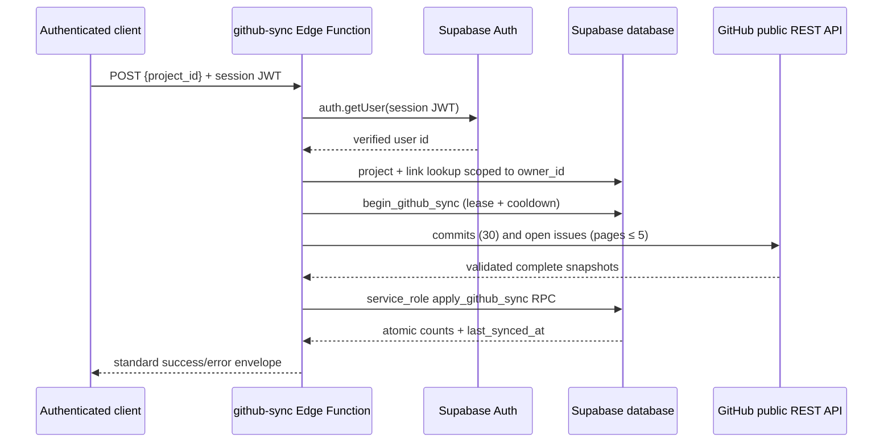

# Makko backend architecture

## Phase 2 synchronization flow



The handler and GitHub logic are intentionally separated in
`supabase/functions/github-sync/index.ts` and `github.ts`. The latter has no
database or secret dependency: repository parsing, URL confinement, response
validation, pagination, mapping, deduplication, and upstream error mapping are
all injectable/testable. The handler owns HTTP validation, CORS, Auth
verification, ownership queries, lease lifecycle, and the final RPC call.

`begin_github_sync` is a short service-role-only transaction that locks the
link, rechecks ownership, enforces the 60-second post-success cooldown, and
persists a random lease token with a bounded two-minute expiry. The network
requests happen after that transaction has committed. A competing invocation
therefore receives a generic `429` before calling GitHub. `apply_github_sync`
requires the matching unexpired token and atomically writes/prunes the full
snapshot, updates `last_synced_at`, and clears the lease. Fetch or apply
failures call `abort_github_sync`, which clears only the matching token.

## Security boundaries

- `verify_jwt = true` remains enabled in `supabase/config.toml`; the handler
  also calls `auth.getUser(token)` and never trusts a decoded JWT claim.
- The caller session JWT is used only for Auth verification. The privileged
  client is created after successful verification with a server-side
  `SUPABASE_SECRET_KEYS` value (or the local legacy service-role fallback).
- The database function is `SECURITY DEFINER`, has `search_path = ''`, uses
  fully qualified objects and no dynamic SQL, and grants `EXECUTE` only to
  `service_role`. It locks the link and rechecks current project ownership.
- GitHub requests are constructed only from the stored validated
  `owner/name`; arbitrary URLs are never accepted. Pagination follows only
  absolute HTTPS `api.github.com` issue links for the same repository.
- Browser origins are an explicit comma-separated allowlist. No-Origin
  requests remain allowed for mobile/server callers. Wildcard authenticated
  CORS is not supported.
- Error responses contain stable semantic codes and generic messages. GitHub
  response bodies, database details, stacks, credentials, and JWTs are not
  returned or logged.

## Deployment

Apply the immutable Phase 2 migration after Phase 1, then deploy the function:

```sh
supabase db push
supabase functions deploy github-sync
```

Set `ALLOWED_ORIGINS` in production to the exact browser origins that call the
function. Hosted Supabase injects `SUPABASE_URL` plus the JSON
`SUPABASE_PUBLISHABLE_KEYS` and `SUPABASE_SECRET_KEYS` maps. Local CLI values
may use `SUPABASE_ANON_KEY` and `SUPABASE_SERVICE_ROLE_KEY` as documented in
`.env.example`; service secrets must remain server-side and must never be
pasted into source control or client code.

GitHub public-data requests are unauthenticated and therefore subject to an
IP-based upstream rate limit. Phase 2 accepts that MVP tradeoff, caps issue
pagination, has no unsafe retries, and returns a safe `429` with
`Retry-After` when GitHub or the local successful-sync cooldown requires it.
