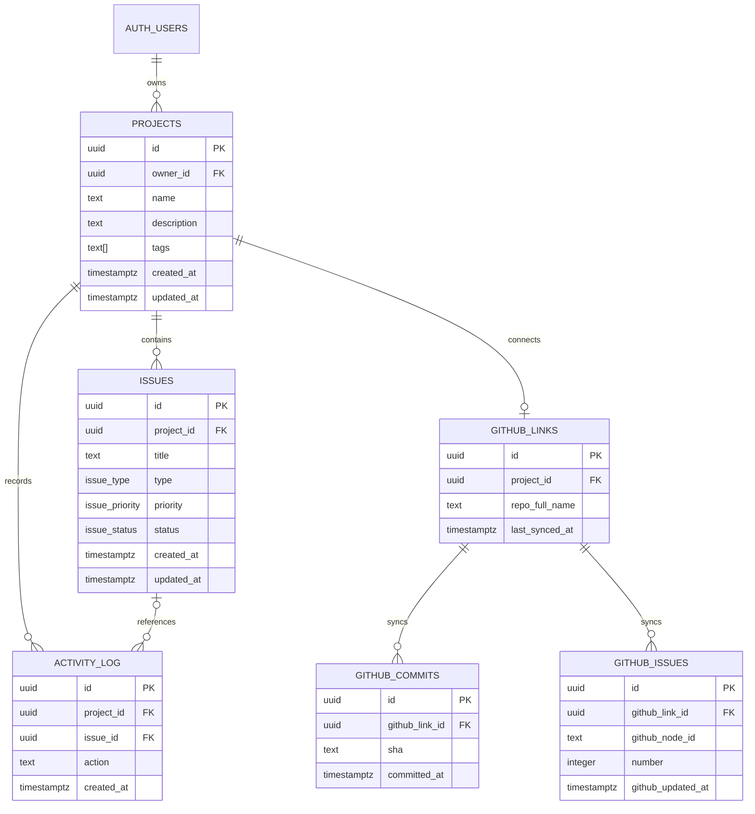

# Makko database contract

Phase 1 is a single forward-only migration:

`supabase/migrations/20260831170000_phase1_database.sql`

Apply corrections in a later migration. Do not edit an already-applied migration.

Phase 2 adds the immutable forward migration
`supabase/migrations/20260831180000_phase2_github_sync_rpc.sql`.

## Schema

All application tables are in `public`. Primary keys use `uuid` with the
`extensions.gen_random_uuid()` default. All application timestamps are
`timestamptz` and default to `now()` unless noted.

### Enums

| Type | Values (in order) |
| --- | --- |
| `issue_type` | `task`, `bug` |
| `issue_priority` | `low`, `medium`, `high` |
| `issue_status` | `todo`, `in_progress`, `done` |

### Tables

| Table | Columns and constraints |
| --- | --- |
| `projects` | `id uuid PK`; `owner_id uuid NOT NULL → auth.users.id ON DELETE CASCADE`; trimmed `name text NOT NULL` (1–120); `description text` (NULL or trimmed 1–5000); `tags text[] NOT NULL DEFAULT {}` (at most 20, trimmed/nonblank values at most 40 characters, case-insensitively unique); `created_at`, `updated_at`. |
| `issues` | `id uuid PK`; `project_id uuid NOT NULL → projects.id ON DELETE CASCADE`; trimmed `title text NOT NULL` (1–200); `description text` (NULL or trimmed 1–10000); `type issue_type NOT NULL`; `priority issue_priority NOT NULL DEFAULT medium`; `status issue_status NOT NULL DEFAULT todo`; `created_at`, `updated_at`. `project_id` cannot change after insert. |
| `activity_log` | `id uuid PK`; `project_id uuid NOT NULL → projects.id ON DELETE CASCADE`; `issue_id uuid → issues.id ON DELETE SET NULL`; `action` is allowlisted to `project.created`, `project.updated`, `issue.created`, `issue.updated`, or `issue.deleted`; `description text NOT NULL` (1–1000); `created_at`. |
| `github_links` | `id uuid PK`; `project_id uuid NOT NULL → projects.id ON DELETE CASCADE`, unique; `repo_full_name text NOT NULL` as validated `owner/name`; `last_synced_at timestamptz`; nullable `sync_lease_token uuid` and `sync_lease_expires_at timestamptz` (both set or both null); `created_at`. |
| `github_commits` | `id uuid PK`; `github_link_id uuid NOT NULL → github_links.id ON DELETE CASCADE`; `sha text NOT NULL` (40–64 hexadecimal characters); `message text NOT NULL` (may be empty); optional author fields; `committed_at timestamptz NOT NULL`; `html_url text NOT NULL`; `synced_at`; unique `(github_link_id, sha)`. |
| `github_issues` | `id uuid PK`; `github_link_id uuid NOT NULL → github_links.id ON DELETE CASCADE`; stable `github_node_id text NOT NULL`; `number integer NOT NULL`; `title`, `state`, optional `author_login`, `labels text[]` (no NULL elements); `github_created_at`, `github_updated_at`, and `html_url` are required GitHub values; `synced_at`; unique `(github_link_id, github_node_id)` and `(github_link_id, number)`. |

GitHub repository names accept one trimmed slash-separated owner and name,
with an owner beginning with an alphanumeric character followed by up to 38
alphanumerics or hyphens, and a name containing 1–100 allowed characters.
The full value is at most 140 characters; final GitHub API validation remains
the synchronization layer's responsibility. GitHub issue state is `open` or
`closed`, and GitHub URLs must be HTTPS `github.com` URLs. Synchronized rows
are not writable through the client role.

## Entity relationship diagram



## Indexes

- `projects(owner_id, updated_at DESC)`
- `issues(project_id, created_at DESC)`, `(project_id, status)`, `(project_id, priority)`, and `(project_id, type)`
- `activity_log(project_id, created_at DESC)` and `activity_log(issue_id)`
- `github_commits(github_link_id, committed_at DESC)`
- `github_issues(github_link_id, github_updated_at DESC)`

Primary-key and unique-constraint indexes are also created by the migration.

## RLS and grants

RLS is enabled on every application table; `FORCE ROW LEVEL SECURITY` is not
used so trusted trigger functions can write activity history.

- `projects`: authenticated users can select, insert, update, and delete rows where `owner_id = (select auth.uid())`.
- `issues`: authenticated users can select, insert, update, and delete rows only through a project they own. Policies use a scalar `(select auth.uid())` lookup, and the trigger makes `project_id` immutable.
- `activity_log`: authenticated users can select history for owned projects only. There are no client insert, update, or delete grants.
- `github_links`: authenticated users can select, insert, and delete links for owned projects. There is no client update grant; insert is limited to `project_id` and `repo_full_name`, so `last_synced_at` cannot be forged.
- `github_commits` and `github_issues`: authenticated users can select synchronized rows belonging to owned projects only. There are no client write grants.
- `anon` receives no table privileges. Trusted synchronization writes are reserved for a server role outside the client grants.

### Atomic synchronization RPC

`public.begin_github_sync(owner_id uuid, github_link_id uuid)`,
`public.abort_github_sync(owner_id uuid, github_link_id uuid, lease_token uuid)`,
and `public.apply_github_sync(owner_id uuid, github_link_id uuid, lease_token
uuid, commits jsonb, issues jsonb)` are narrow `SECURITY DEFINER` functions
reserved for `service_role`. `PUBLIC`, `anon`, and `authenticated` have no
`EXECUTE` privilege on any of them. Each function uses an empty
`search_path`, fully qualified objects, and no dynamic SQL.

`github_links.sync_lease_token` and `sync_lease_expires_at` persist a bounded
two-minute lease. Begin locks the link, verifies current project ownership,
rejects an active lease or the 60-second post-success cooldown, and returns
the link data plus a random lease token. The Edge Function performs GitHub
network requests only after that transaction commits. Abort clears only a
matching owner/link/token; a mismatched token is a no-op.

The function accepts complete arrays of at most 30 commits and 500 issues,
locks the link row, and verifies that its current project is still owned by the
provided owner. It then deduplicates by `(github_link_id, sha)` and
`(github_link_id, github_node_id)`, upserts rows, prunes cached rows absent from
the complete snapshot (an empty array removes all rows), and updates
`last_synced_at` only after every write succeeds while clearing the matching
lease. PostgreSQL table constraints remain the final validator of row formats
and lengths. Any malformed payload or constraint error rolls back the entire
snapshot; the handler then calls abort to release the lease.

## Triggers

`projects` and `issues` have safe `updated_at` triggers: a timestamp changes
only when a meaningful mutable field changes. Identical or timestamp-only
updates do not create activity.

Security-definer activity triggers use `SET search_path = ''`, fully qualified
application objects, no dynamic SQL, and revoked execute privileges. They record
`project.created`/`project.updated` and `issue.created`/`issue.updated` activity.
An issue deleted directly while its project exists records `issue.deleted` with
a NULL `issue_id`, preserving history after the issue row is removed. Issue
deletes caused by a project or account cascade skip that insert because the
parent project is already gone; the project's cascade then removes its
dependent activity rows. The immutable tag validator is the sole private
function executable by `authenticated`, because PostgreSQL checks its
EXECUTE privilege when evaluating the project tags constraint.

## Verification

The pgTAP suites are `supabase/tests/database/phase1_database.test.sql` and
`supabase/tests/database/phase2_github_sync.test.sql`; each runs inside one
transaction, rolling back all fixtures at the end. With the native Supabase
CLI:

```sh
supabase test db
```

The Phase 1 suite covers enums, tables, constraints, indexes, RLS isolation
between two users, forbidden direct activity/GitHub writes, protected link
sync timestamps, activity trigger behavior, immutable issue ownership, and
foreign-key cascades. Phase 2 additionally covers RPC privileges, ownership
rejection without writes, deduplicating upserts, stale and empty snapshot
pruning, timestamp behavior, rollback on invalid rows, and project/link
cascades.
